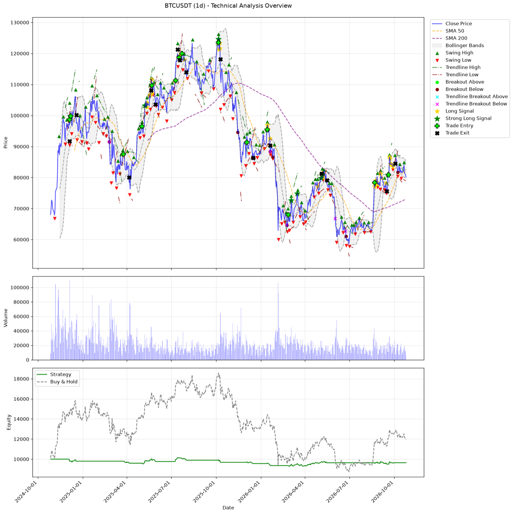

# Algorithmic Trading System

[](https://github.com/cagriefe/algorithmic-trading/actions/workflows/tests.yml)

A Python toolkit that analyses cryptocurrency markets on Binance with technical indicators, price action and chart
patterns, combines them into a weighted signal score, and backtests the resulting long signals with realistic
execution and risk management.



## Features

- **Technical indicators** (TA-Lib): SMA and EMA (50/200), RSI, MACD, ADX with +DI/-DI, ATR, Bollinger Bands and a
  20-bar volume average.
- **Price action**: swing highs and lows, breakouts through the last *confirmed* swing level, trendlines through the
  last two confirmed pivots and trendline breakouts. Breakouts need a trending market (ADX > 25) and above-average
  volume.
- **Chart patterns**: head and shoulders (and inverse), double and triple tops/bottoms, bull and bear flags, cup and
  handle, rectangles. Patterns are built from confirmed pivots with ATR-scaled tolerances, so the same settings work
  for BTC at 100,000 and APE at 0.10.
- **Signal scoring**: a weighted multi-factor score turns every bar into *Strong Long*, *Long* or *Neutral*, with a
  readable explanation.
- **Backtesting**: next-bar fills, ATR-based stop loss and take profit, risk-based position sizing, fees and slippage,
  a buy & hold benchmark and standard performance metrics.
- **No look-ahead bias**: every signal only uses data available at the close of its bar. A test runs the pipeline on
  truncated histories and checks that the signals match the full history bar for bar.
- **CLI, CSV and Docker**: any Binance pair, interval and date range, offline analysis of your own CSV data, charts
  saved as PNG (works headless) and a ready-to-run Docker image.

## How signals are scored

| Component          | Condition                                                         | Weight |
|--------------------|-------------------------------------------------------------------|-------:|
| Trendline breakout | Close crosses above the resistance trendline                      |    5.0 |
| Swing breakout     | Close crosses above the last confirmed swing high                 |    4.0 |
| Trend strength     | ADX > 25 and +DI > -DI (uptrend)                                  |    3.0 |
| MACD               | MACD above its signal line                                        |    2.0 |
| Moving averages    | Close above SMA 50 and EMA 50                                     |    2.0 |
| Volume             | Volume above its 20-bar average                                   |    1.5 |
| RSI                | RSI between 30 and 70                                             |    1.0 |
| Bullish pattern    | Inverse H&S, double/triple bottom, bull flag or cup and handle    |    2.5 |

Confidence is the score as a percentage of the maximum score (21). Each bar gets a decision:

- **Strong Long**: score > 10 and confidence > 60%
- **Long**: score > 7 and confidence > 40%
- **Neutral**: everything else

## Backtesting

The backtest simulates the *Long* and *Strong Long* signals with these rules:

- A signal on a bar's close is filled at the **next bar's open**.
- Every trade gets a **stop loss** 2 ATR below and a **take profit** 4 ATR above the entry (1:2 risk/reward).
- The **position size** risks 2% of equity at the stop and never exceeds the available cash (no leverage).
- A price gap through a level fills at the open. If one bar touches both levels, the stop is assumed to be hit first.
- A close below support (swing or trendline breakdown) exits at the next open. An optional time exit is available.
- Every fill pays a 0.1% fee and 0.05% slippage.

It reports total return, buy & hold return, max drawdown, Sharpe ratio, number of trades, win rate, profit factor,
average trade return, average holding period, exposure and fees. All rules can be changed from the command line.

## Installation

Requires Python 3.11 or newer. The TA-Lib wheels include the C library, so nothing else has to be installed.

```bash
git clone https://github.com/cagriefe/algorithmic-trading.git
cd algorithmic-trading
python -m venv .venv
source .venv/bin/activate  # Windows: .venv\Scripts\activate
pip install -r requirements.txt
```

No Binance account or API keys are needed: market data comes from Binance's public endpoints. Where
`api.binance.com` is geo-restricted (HTTP 451, e.g. US cloud servers), the client automatically switches to the
public market-data mirror `data-api.binance.vision`.

## Usage

```bash
# APEUSDT daily candles from the last year (the defaults)
python main.py

# Any pair, interval and date range
python main.py --symbol BTCUSDT --interval 4h --start "6 months ago UTC"
python main.py --symbol ETHUSDT --start 2023-01-01 --end 2024-01-01

# Custom risk management
python main.py --symbol SOLUSDT --risk 0.01 --stop-atr 1.5 --take-profit-atr 3 --max-hold 20

# Your own OHLCV data (timestamp/date, open, high, low, close, volume columns)
python main.py --csv data/prices.csv

# Also open the chart in a window
python main.py --show
```

`python -m algotrading` works the same way. Run `python main.py --help` to see every option. Binance.US users can add
`--tld us`.

Results are written to `output/`:

| File                               | Contents                                                                              |
|------------------------------------|---------------------------------------------------------------------------------------|
| `<SYMBOL>_<interval>_analysis.csv` | Every bar with indicators, breakouts, patterns, score, decision, reasoning and equity |
| `<SYMBOL>_<interval>_trades.csv`   | Every trade with entry, exit, stop loss, take profit, exit reason and P&L             |
| `<SYMBOL>_<interval>_chart.png`    | Price chart with signals and trades, volume and the equity curve                      |

### Example output

`python main.py --symbol BTCUSDT --start "2 years ago UTC"` (excerpt):

```
CURRENT SIGNAL:
--------------------------------------------------------------------------------
Date: 2026-10-25 00:00:00
Score: 1.00
Confidence: 4.8%
Decision: Neutral
Close Price: 80154.09
Reasoning: RSI in healthy range (weight: 1.0)
--------------------------------------------------------------------------------

=== Backtest Results ===
--------------------------------------------------------------------------------
Period:               2024-10-27 -> 2026-10-25
Initial capital:      10,000.00
Final equity:         9,640.85
Total return %:       -3.59
Buy & hold return %:  19.47
Max drawdown %:       -8.47
Sharpe ratio:         -0.27
Trades:               15
Win rate %:           33.33
Profit factor:        0.78
Avg trade return %:   -0.37
Avg bars held:        13.73
Exposure %:           28.26
Fees paid:            98.89
--------------------------------------------------------------------------------
Exit reasons: Stop loss: 6, Breakdown: 6, Take profit: 3
```

With the default settings the strategy lost 3.6% over this period while buy & hold gained 19.5%, although it was
only in the market 28% of the time and its drawdown stayed under 9%. Measuring signals honestly before risking money
is exactly what the backtest is for.

## Docker

```bash
# Run the command defined in docker-compose.yml; results appear in ./output
docker compose up --build

# Or pass any CLI options
docker build -t algotrading .
docker run --rm -v "$(pwd)/output:/app/output" algotrading --symbol BTCUSDT --interval 4h
```

## Project structure

```
algotrading/
├── data.py          # Binance klines and CSV loading
├── indicators.py    # TA-Lib indicators
├── price_action.py  # swing points, breakouts and trendlines
├── patterns.py      # chart pattern recognition
├── signals.py       # weighted signal scoring and decisions
├── analysis.py      # the full analysis pipeline
├── backtest.py      # trade simulation and performance metrics
├── report.py        # console reports
├── plotting.py      # charts
└── cli.py           # command-line interface
tests/               # offline pytest suite
main.py              # entry point
```

## Testing

```bash
pip install -r requirements-dev.txt
pytest
```

The tests run offline on synthetic data and cover every module: indicators and price action, each chart pattern,
signal scoring, backtest fills and metrics, data loading and the CLI. GitHub Actions runs them on Python 3.11, 3.12
and 3.13.

## Future Improvements

- Parameter optimisation with walk-forward validation
- Short selling and bearish signals
- Multiple timeframe confirmation
- Portfolio optimisation across several pairs
- Machine learning integration
- Paper trading and real-time execution
- Web interface for monitoring

## Disclaimer

This project is for educational and research purposes only and is not financial advice. Backtest results do not
guarantee future performance. Use it at your own risk.

## License

This project is licensed under the GNU General Public License v3.0 - see the [LICENSE](LICENSE) file for details.

## Contributing

Contributions are welcome! Please feel free to submit a Pull Request.

1. Fork the repository
2. Create your feature branch (`git checkout -b feature/my-feature`)
3. Make sure the tests pass (`pytest`)
4. Commit your changes and push the branch
5. Open a Pull Request
