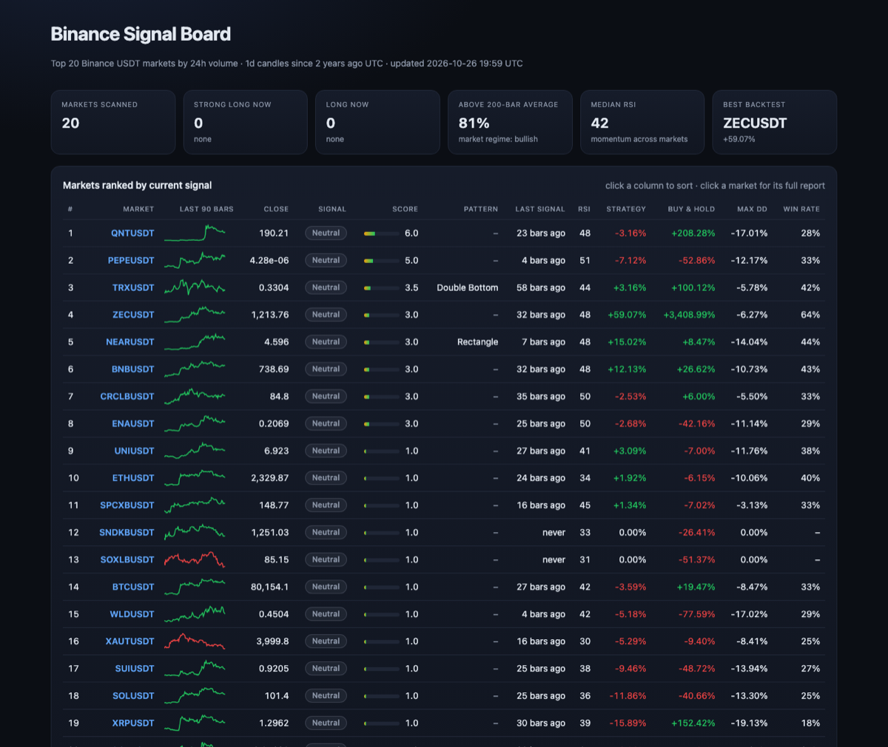
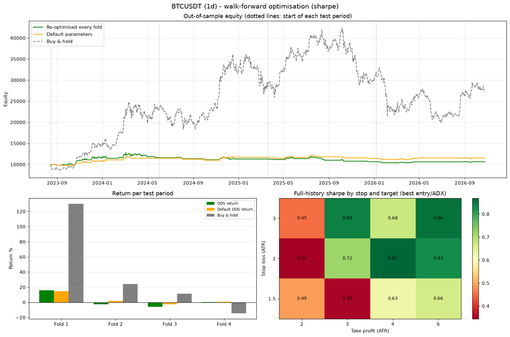
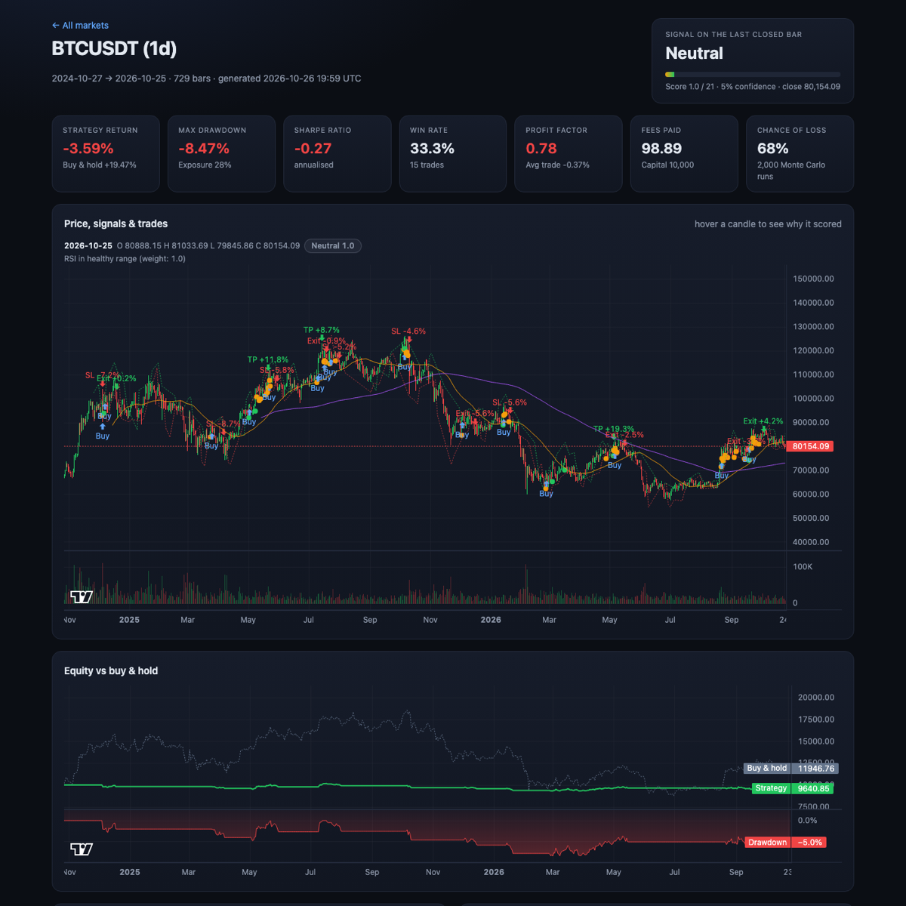

# Algorithmic Trading System

[](https://github.com/cagriefe/algorithmic-trading/actions/workflows/tests.yml)
[](http://www.cagriefe.com/algorithmic-trading/)

A Python toolkit for cryptocurrency markets on Binance. It turns technical indicators, price action and chart
patterns into a weighted signal score, backtests the signals with realistic execution, stress-tests the results
with Monte Carlo simulation and walk-forward optimisation, scans the whole market and publishes a live dashboard
with Telegram/Discord alerts.

**Live dashboard: [www.cagriefe.com/algorithmic-trading](http://www.cagriefe.com/algorithmic-trading/)** - the 20
most traded Binance markets, re-scanned every day by GitHub Actions.



## Features

- **Signals**: TA-Lib indicators (SMA/EMA 50/200, RSI, MACD, ADX with +DI/-DI, ATR, Bollinger Bands), swing
  breakouts, causal trendlines and 10 chart patterns combine into a weighted score per candle: *Strong Long*,
  *Long* or *Neutral*, with a readable explanation.
- **Backtesting**: next-bar fills, ATR stop loss and take profit, risk-based position sizing, fees and slippage,
  compared with buy & hold.
- **Robustness**: Monte Carlo resampling shows how much of a result is luck; walk-forward optimisation tunes
  parameters only on past data and measures them on unseen periods; the signal edge table shows which signals
  actually predicted price moves.
- **Market scanner**: analyses and backtests the most traded markets in parallel and ranks them by current signal.
- **Interactive reports and dashboard**: TradingView-style charts with a hover explanation for every candle,
  equity and drawdown, trade plans, Monte Carlo and edge tables - as plain HTML files.
- **Alerts**: Telegram and Discord messages with an entry, stop and target when a new signal appears.
- **No look-ahead bias**: signals only use data available at the close of their candle, verified by tests.
- **No API keys**: public Binance market data, with an automatic fallback for geo-restricted regions.

## Commands

| Command | What it does |
|---------|--------------|
| `python main.py analyze` | Analyse and backtest one market; `--html` for an interactive report, `--edge` for the signal edge table. The default command. |
| `python main.py scan` | Rank the most traded markets by current signal; `--html` builds the dashboard, `--alert` sends a digest. |
| `python main.py optimize` | Walk-forward optimisation of stop loss, take profit, entry level and ADX threshold. |
| `python main.py watch` | Check markets at every candle close and alert on new signals. |

Run `python main.py <command> --help` for every option.

## Installation

Requires Python 3.11 or newer. The TA-Lib wheels include the C library, so nothing else has to be installed.

```bash
git clone https://github.com/cagriefe/algorithmic-trading.git
cd algorithmic-trading
python -m venv .venv
source .venv/bin/activate  # Windows: .venv\Scripts\activate
pip install -r requirements.txt
```

No Binance account or API keys are needed: market data comes from Binance's public endpoints. Where
`api.binance.com` is geo-restricted (HTTP 451, e.g. US cloud servers), the client automatically switches to the
public market-data mirror `data-api.binance.vision`.

## Usage

```bash
# One market: APEUSDT daily candles from the last year (the defaults)
python main.py
python main.py --symbol BTCUSDT --interval 4h --start "6 months ago UTC" --html --edge

# Custom risk management
python main.py --symbol SOLUSDT --risk 0.01 --stop-atr 1.5 --take-profit-atr 3 --max-hold 20

# Your own OHLCV data (timestamp/date, open, high, low, close, volume columns)
python main.py --csv data/prices.csv

# Rank the 20 most traded USDT markets and build the dashboard
python main.py scan --top 20 --start "2 years ago UTC" --html
python main.py scan --symbols BTCUSDT,ETHUSDT,SOLUSDT --interval 4h

# Walk-forward optimisation over four years, maximising the Sharpe ratio
python main.py optimize --symbol BTCUSDT --start "4 years ago UTC" --folds 4 --objective sharpe

# Alerts whenever a 4h candle closes with a new signal
python main.py watch --symbols BTCUSDT,ETHUSDT,SOLUSDT --interval 4h
```

Results are written to `output/`: the full analysis and trades as CSV, a PNG chart, HTML reports, `scan.csv` with
the dashboard (`index.html` plus `reports/`), and the walk-forward tables and chart.

## How signals are scored

| Component          | Condition                                                         | Weight |
|--------------------|-------------------------------------------------------------------|-------:|
| Trendline breakout | Close crosses above the resistance trendline                      |    5.0 |
| Swing breakout     | Close crosses above the last confirmed swing high                 |    4.0 |
| Trend strength     | ADX > 25 and +DI > -DI (uptrend)                                  |    3.0 |
| MACD               | MACD above its signal line                                        |    2.0 |
| Moving averages    | Close above SMA 50 and EMA 50                                     |    2.0 |
| Volume             | Volume above its 20-bar average                                   |    1.5 |
| RSI                | RSI between 30 and 70                                             |    1.0 |
| Bullish pattern    | Inverse H&S, double/triple bottom, bull flag or cup and handle    |    2.5 |

Breakouts only count in trending markets (ADX > 25) with above-average volume. Chart patterns (head and shoulders,
double/triple tops and bottoms, flags, cup and handle, rectangles) are built from confirmed swing pivots with
ATR-scaled tolerances, so they work for BTC at 100,000 and for a coin at 0.10.

Confidence is the score as a percentage of the maximum score (21). **Strong Long** needs a score above 10 and more
than 60% confidence, **Long** a score above 7 and more than 40%; everything else is **Neutral**.

## Backtesting

- A signal on a candle's close is filled at the **next candle's open**.
- Every trade gets a **stop loss** 2 ATR below and a **take profit** 4 ATR above the entry (1:2 risk/reward).
- The **position size** risks 2% of equity at the stop and never exceeds the available cash (no leverage).
- A price gap through a level fills at the open. If one candle touches both levels, the stop counts first.
- A close below support exits at the next open; an optional time exit is available.
- Every fill pays a 0.1% fee and 0.05% slippage.

Reported: total return vs buy & hold, max drawdown, Sharpe ratio, win rate, profit factor, average trade,
holding period, exposure and fees. All rules can be changed from the command line.

## Research tools

**Monte Carlo** (printed after every backtest) resamples the trades 2,000 times. On BTCUSDT daily over three years
the backtest made +5.8%, but the resampled range ran from -13.5% (5th percentile) to +31.8% (95th) with a 33%
chance of losing money - the result was not statistically robust.

**Signal edge** (`--edge`) shows the average return 5, 10 and 20 candles after every decision, scoring condition
and pattern, its hit rate and its edge over an average candle. On the same data trendline breakouts beat an
average candle by 3.1% over 10 days, while plain *Long* signals did not.

**Walk-forward optimisation** (`optimize`) splits the history into folds. Each fold searches 72 parameter sets on
all earlier data and trades the next, unseen period with the winner; only those out-of-sample periods are
stitched together and compared with the default parameters and buy & hold. The walk-forward efficiency shows how
much of the in-sample performance survived out of sample.



In this BTCUSDT run the re-optimised parameters did *worse* out of sample than the defaults (19% efficiency): the
best parameters of the past were mostly fitted to noise. Seeing this before risking money is the point.

## Interactive reports

`--html` (and every market on the dashboard) produces a self-contained report: candlesticks with moving averages,
trendlines, signals and labelled trades; a hover legend that explains the score of any candle; equity and drawdown
synchronised with the price chart; a checklist of the scoring conditions on the last candle; a trade plan with
entry, stop, target and position size for a fresh signal; Monte Carlo and signal edge tables; and the trade list.



## Alerts

Alerts always go to the console. To receive them on your phone, set one or both channels in a `.env` file, as
environment variables or as GitHub repository secrets:

| Variable | How to get it |
|----------|---------------|
| `TELEGRAM_BOT_TOKEN` | Message [@BotFather](https://t.me/BotFather), send `/newbot` and copy the token. |
| `TELEGRAM_CHAT_ID` | Send your bot a message, open `https://api.telegram.org/bot<TOKEN>/getUpdates` and copy `chat.id`. |
| `DISCORD_WEBHOOK_URL` | Server settings &rarr; Integrations &rarr; Webhooks &rarr; New webhook &rarr; Copy URL. |

```
🟡 Long signal: CHIPUSDT (1h)
Close 0.054910 | score 8.5/21 (40%)
Plan: stop 0.051028 (-7.1%), target 0.062674 (+14.1%)
Why: Strong uptrend - ADX>25, +DI>-DI | MACD above signal line | Above key moving averages | Above-average volume
Candle: 2026-10-26 18:00 UTC
```

`watch` remembers which candles it already alerted on, so restarts never send duplicates; `--once` runs a single
check for cron.

## Live dashboard on GitHub Pages

[`.github/workflows/dashboard.yml`](.github/workflows/dashboard.yml) runs `scan --html` every day shortly after the
daily candle closes and deploys the result to GitHub Pages. With the Telegram or Discord secrets set, the daily run
also sends a digest of the new signals - a free, serverless alert service. To run your own board, fork the
repository and choose *Settings &rarr; Pages &rarr; Source: GitHub Actions*.

## Docker

```bash
# Analyse one market; results appear in ./output
docker compose up --build app

# 24/7 alerts (reads TELEGRAM_* / DISCORD_WEBHOOK_URL from .env)
docker compose --profile alerts up -d watch

# Any command
docker build -t algotrading .
docker run --rm -v "$(pwd)/output:/app/output" algotrading scan --top 10 --html
```

## Project structure

```
algotrading/
├── data.py          # Binance REST client (klines, tickers, geo fallback) and CSV loading
├── indicators.py    # TA-Lib indicators
├── price_action.py  # swing points, breakouts and trendlines
├── patterns.py      # chart pattern recognition
├── signals.py       # weighted signal scoring and decisions
├── analysis.py      # the full analysis pipeline
├── backtest.py      # trade simulation and performance metrics
├── montecarlo.py    # Monte Carlo resampling of trades
├── edge.py          # forward returns after each signal
├── optimize.py      # walk-forward parameter optimisation
├── scanner.py       # parallel multi-market scan
├── alerts.py        # Telegram/Discord alerts and candle timing
├── html_report.py   # interactive single-market report
├── dashboard.py     # market dashboard
├── assets/          # report and dashboard CSS/JS
├── report.py        # console reports
├── plotting.py      # PNG charts
└── cli.py           # command-line interface
tests/               # 104 offline pytest tests
main.py              # entry point
```

## Testing

```bash
pip install -r requirements-dev.txt
pytest
```

The tests run offline on synthetic data and mocked HTTP. Besides unit tests for every module they check that
signals never use future data (truncated histories give identical signals), that later data cannot change earlier
walk-forward folds, that the Monte Carlo matches a binomial model, and that alert errors never leak secrets.
GitHub Actions runs them on Python 3.11 (pandas 2.2), 3.12 and 3.13.

## Future Improvements

- Short selling and bearish signals
- Multiple timeframe confirmation
- Portfolio backtests across several markets
- Machine learning signal filters (meta-labelling)
- Paper trading and real-time execution

## Disclaimer

This project is for educational and research purposes only and is not financial advice. Backtest results do not
guarantee future performance. Use it at your own risk.

## License

This project is licensed under the GNU General Public License v3.0 - see the [LICENSE](LICENSE) file for details.

## Contributing

Contributions are welcome! Please feel free to submit a Pull Request.

1. Fork the repository
2. Create your feature branch (`git checkout -b feature/my-feature`)
3. Make sure the tests pass (`pytest`)
4. Commit your changes and push the branch
5. Open a Pull Request
